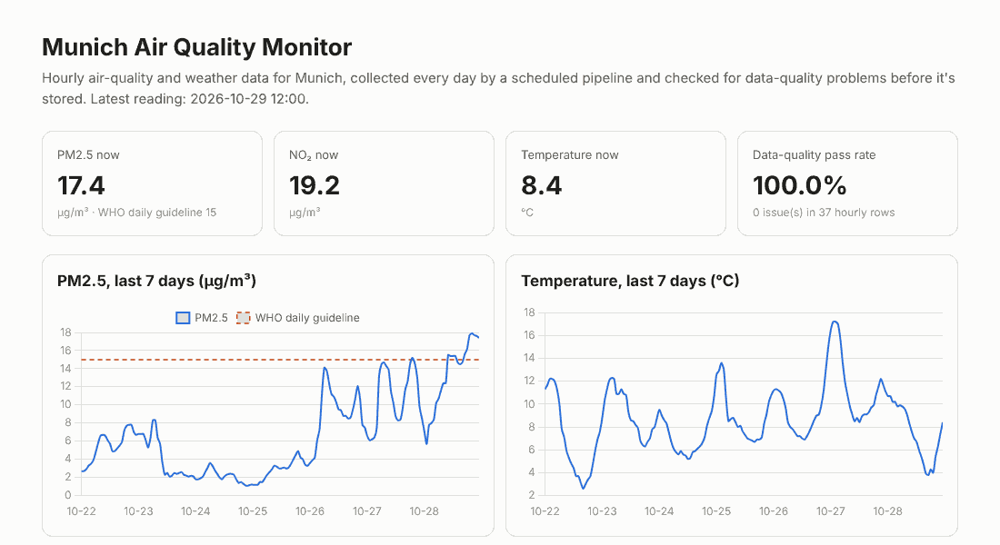
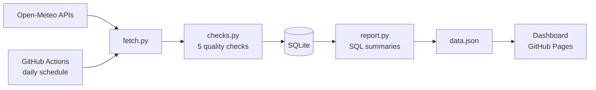

# Munich Air Quality Monitor

[](https://github.com/rafiasimran/munich-air-quality-monitor/actions/workflows/tests.yml) [](https://github.com/rafiasimran/munich-air-quality-monitor/actions/workflows/daily.yml)

A small, automated data pipeline that collects hourly air-quality and weather data for Munich every day, checks it for data-quality problems, stores it in SQLite and publishes a live dashboard.

**[Live dashboard](https://rafiasimran.github.io/munich-air-quality-monitor/)**



## Why I built it

Most data projects I'd seen started from a clean CSV. Real data doesn't arrive like that: sensors drop out, values freeze, timestamps go missing. I wanted to practise the part that comes *before* analysis, which is making sure the data can be trusted, and to have it run on its own every day rather than once on my laptop.

## What it does

Every morning a GitHub Actions job:

1. **Fetches** the last 48 hours of hourly data for Munich from the free [Open-Meteo](https://open-meteo.com/) APIs: PM2.5, PM10, NO₂, ozone, temperature, humidity and wind speed.
2. **Checks** every value before storing it:
   - **missing values**
   - **out-of-range values** (for example humidity above 100% or negative PM2.5)
   - **sudden jumps** that are too large for one hour
   - **stuck values**, where the same reading repeats for 6+ hours (a classic sign of a frozen sensor)
   - **missing or duplicate timestamps**
3. **Stores** the measurements, the issues found and a summary of each run in **SQLite**. Re-running updates rows instead of duplicating them.
4. **Reports** daily averages with plain SQL and compares PM2.5 against the **WHO daily guideline** (15 µg/m³).
5. **Publishes** the results to a static dashboard on GitHub Pages and commits the updated database back to the repo.



## Project structure

```
src/
  config.py    city, API settings, valid ranges and thresholds
  fetch.py     download and merge air-quality + weather data
  checks.py    the data-quality checks
  store.py     SQLite schema and upserts
  report.py    SQL summaries for the dashboard
  main.py      runs the whole pipeline
tests/         pytest tests using a real 48-hour sample
docs/          the dashboard (index.html + data.json)
data/          the SQLite database, updated daily
```

## Testing

The tests use 48 real hours of Munich data captured from the API. That sample is clean, so each test breaks it on purpose (removes a value, pushes humidity to 140%, freezes the ozone sensor, deletes three hours) and checks that the right problem is caught. Tests run on every push and before every daily run.

```bash
pip install -r requirements.txt
pytest -q
python src/main.py
```

## Notes and limitations

- Open-Meteo's air-quality values come from the CAMS European air-quality model rather than a single street sensor, so they describe the city area, not one location.
- The thresholds in `config.py` are sensible defaults I chose, not official standards (apart from the WHO guideline).
- To monitor another city, change the coordinates in `config.py`.

## What I'd add next

- Email or Slack alerts when a check fails
- A longer history and weekly trend charts
- More cities for comparison

## Tech

Python · SQL (SQLite) · requests · pytest · GitHub Actions · GitHub Pages · Chart.js

---

Built by **Rafia Imran** · [GitHub profile](https://github.com/rafiasimran) · [Live CV](https://rafiaimran.cloud)
Data: [Open-Meteo](https://open-meteo.com/), licensed CC BY 4.0
