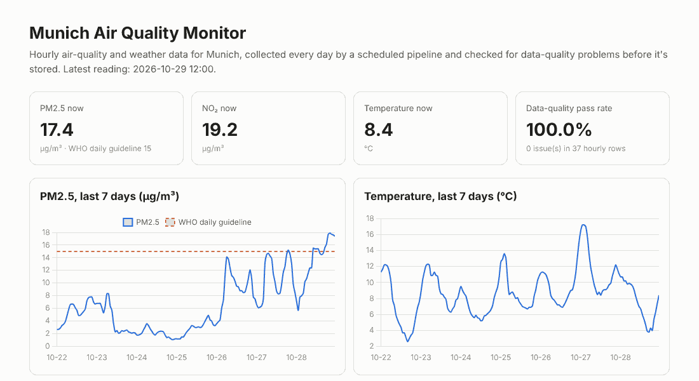
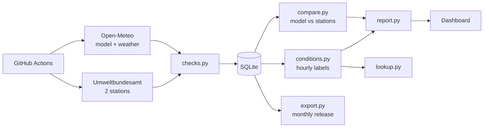

# Munich Air Quality Monitor

[](https://github.com/rafiasimran/munich-air-quality-monitor/actions/workflows/tests.yml) [](https://github.com/rafiasimran/munich-air-quality-monitor/actions/workflows/daily.yml)

An automated pipeline that collects hourly air-quality and weather data for Munich every day, compares a model with real measuring stations, checks everything for data-quality problems and labels each hour with the conditions an outdoor robot, drone or vehicle would have faced.

**[Live dashboard](https://rafiasimran.github.io/munich-air-quality-monitor/)**



## Why I built it

Most data projects I'd seen started from a clean CSV. Real data doesn't arrive like that: sensors drop out, values freeze, timestamps go missing. I wanted to practise the part that comes *before* analysis, which is making sure the data can be trusted, and to have it run on its own every day rather than once on my laptop.

It grew a second purpose. Cameras and lidar on outdoor robots, drones and cars get worse in rain, fog and dusty, humid air. A team with timestamped sensor recordings from Munich can join this project's hourly labels onto them and ask a useful question: does our model fail more often in bad conditions?

## What it does

Every morning a GitHub Actions job:

1. **Fetches** the latest hourly data for Munich from the free [Open-Meteo](https://open-meteo.com/) APIs: PM2.5, PM10, NO₂, ozone, temperature, humidity, wind, rain and visibility. These air-quality values come from the CAMS European model.
2. **Fetches real measurements** from two stations in Bavaria's air monitoring network, through the [Umweltbundesamt](https://luftdaten.umweltbundesamt.de/en) API (v4): München/Lothstraße (city background) and München/Landshuter Allee (one of Munich's busiest roads).
3. **Checks** every value before storing it:
   - **missing values**
   - **out-of-range values** (for example humidity above 100% or negative PM2.5)
   - **sudden jumps** that are too large for one hour
   - **stuck values**, where the same reading repeats too long (6 hours for the model, 12 for stations, see below)
   - **PM2.5 above PM10**, which can't be physically right because PM2.5 is part of PM10
   - **missing or duplicate timestamps**
4. **Compares the model with the stations**, hour by hour: bias, average error and correlation for each pollutant.
5. **Labels every hour**: `rain`, `strong_wind`, `low_visibility`, `haze_risk` or `clear`, plus an overall risk for cameras and lidar (low, medium, high).
6. **Stores** everything in **SQLite**. Re-running updates rows instead of duplicating them.
7. **Publishes** a dashboard on GitHub Pages and commits the updated database back to the repo.

Once a month, a second job exports the previous month as a **versioned dataset**: CSV files plus a data card, published as a GitHub release.



## What the real stations showed

**Model vs sensor, 17 Oct to 3 Nov 2026** (about 420 hours per station; bias above zero means the model reads too high, in µg/m³):

| | Lothstraße (background) | Landshuter Allee (busy road) |
|---|---|---|
| NO₂ | bias −0.1, correlation 0.71 | bias **−9.6**, correlation 0.41 |
| PM2.5 | bias +1.5, correlation 0.74 | bias +2.1, correlation 0.59 |
| PM10 | bias −4.3, correlation 0.51 | bias −3.9, correlation 0.68 |
| Ozone | bias +5.4, correlation 0.73 | not measured there |

At the background station the model gets NO₂ almost exactly right on average. On the busy road it reads about 10 µg/m³ too low (measured average 25.6, model 15.9) and follows the ups and downs much less well. The model describes the city in roughly 10 km squares, so it can't see the traffic right next to the sensor. For anyone using the model as "ground truth", that is the gap to plan for.

- **PM2.5 above PM10.** Lothstraße reported more PM2.5 than PM10 in 70 hours of this period; on 1 and 2 Nov it was 25 of 48 hours, up to 11 against 2 µg/m³. PM2.5 is part of PM10, so one of the two instruments is off. These hours are kept but marked, because a model trained on them would learn something that can't happen.
- **Whole numbers repeat.** Stations report whole µg/m³, so at low levels the same value often repeats: Landshuter Allee showed PM2.5 = 8 for 7 hours in a row. The 6-hour stuck-sensor rule I wrote for the model would call that a frozen sensor. For stations it is 12 hours.
- **Time zones.** The stations use German winter time (UTC+1) all year, while Open-Meteo uses Munich clock time. The API's v4 notes say "CET or CEST", but the data doesn't follow that: both clock-change days have 24 hours, and 29 March has a 02:00 hour that doesn't exist on a German clock. A test pins this down. The station checks run on UTC, because on the night the clocks go back two real hours share one Munich label.
- **The API is being retired under me.** The first live run lost one station because v3 of the UBA API already fails some requests on purpose before it is switched off in February 2027. The pipeline now uses v4, retries failed requests, and skips a station for the day rather than stopping.

## Look up the conditions at any time

```bash
python src/lookup.py "2026-11-02 08:30"
python src/lookup.py "2026-11-02 08:30" --lat 48.150 --lon 11.540
```

It returns the model and weather values for that hour, the condition labels, and the values measured at the nearest of the two stations. In Python: `from lookup import conditions_at`.

## Monthly dataset

`python src/export.py 2026-10` writes `releases/2026-10/` with `hourly_conditions.csv`, `stations.csv` and a `DATA_CARD.md` (coverage, label counts, sources, known limits). The monthly workflow does this on the 2nd of each month and publishes it as a release, so a team can say exactly which version they trained on.

## Project structure

```
src/
  config.py      city, APIs, stations, valid ranges, label thresholds
  fetch.py       download and merge Open-Meteo air quality + weather
  stations.py    download real station readings (Umweltbundesamt)
  checks.py      the data-quality checks
  store.py       SQLite schema and upserts
  compare.py     model vs station, hour by hour
  conditions.py  hourly condition labels
  lookup.py      conditions at a given time and place
  export.py      monthly dataset with a data card
  report.py      SQL summaries for the dashboard
  main.py        runs the daily pipeline
tests/           pytest tests using real samples from both APIs
docs/            the dashboard (index.html + data.json)
data/            the SQLite database, updated daily
releases/        monthly dataset exports
```

## Testing

24 tests. They use real data: 48 hours from Open-Meteo and 48 hours from the two stations, captured from the APIs. The Open-Meteo sample is clean, so those tests break it on purpose (remove a value, push humidity to 140%, freeze the ozone sensor, delete three hours) and check that the right problem is caught. The station sample isn't clean, and the tests check that the real problems in it are found. Tests run on every push and before every daily run.

```bash
pip install -r requirements.txt
pytest -q
python src/main.py
```

## Notes and limitations

- Open-Meteo's air-quality values come from a model, so they describe the city area, not one street. That's why the stations are there.
- Station values are provisional until the monitoring network validates them, and they can change later.
- The condition thresholds (in `config.py`) are my own working definitions, not official ones. Visibility comes from a weather model too, not from a measurement.
- In the hour the clocks go back, two hours share one Munich time label. The station table also stores UTC, which doesn't have this problem.
- The history starts on 17 Oct 2026, so the first monthly export is partial.

## What I'd add next

- Use the labels on a real public robot or driving dataset recorded in Munich
- More stations and a map
- Alerts when a check fails

## Tech

Python · SQL (SQLite) · requests · pytest · GitHub Actions · GitHub Pages · Chart.js

---

Built by **Rafia Imran** · [GitHub profile](https://github.com/rafiasimran) · [Live CV](https://rafiaimran.cloud)
Data: [Open-Meteo](https://open-meteo.com/), licensed CC BY 4.0 · Umweltbundesamt, with data from Bavaria's air monitoring network
